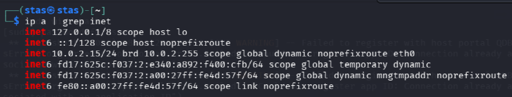
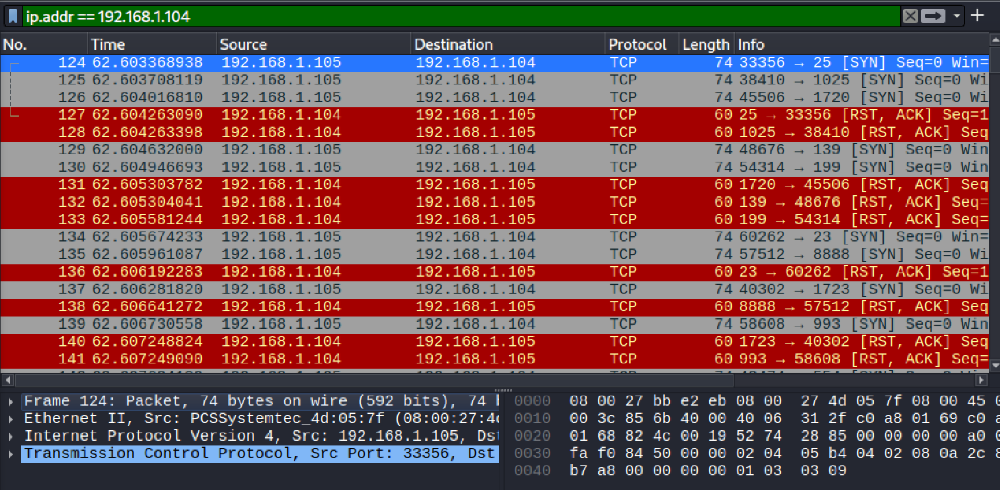
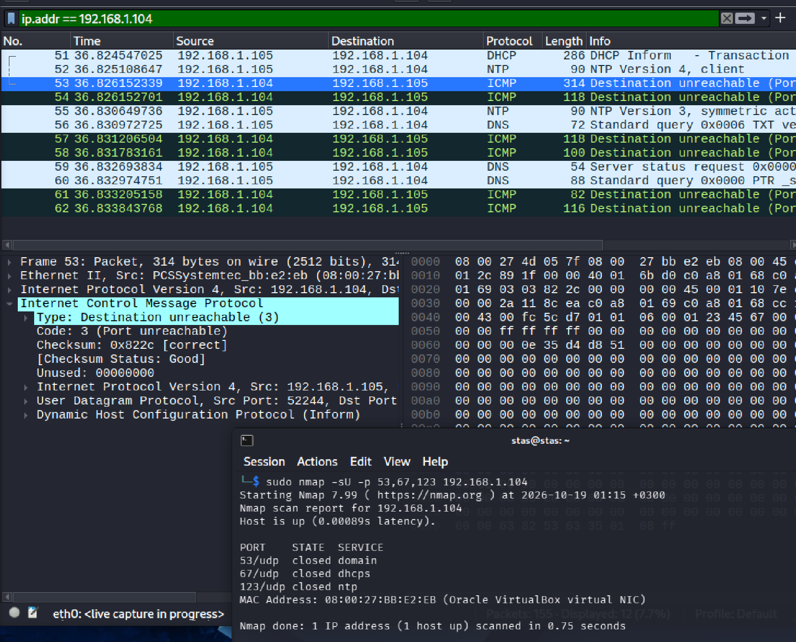
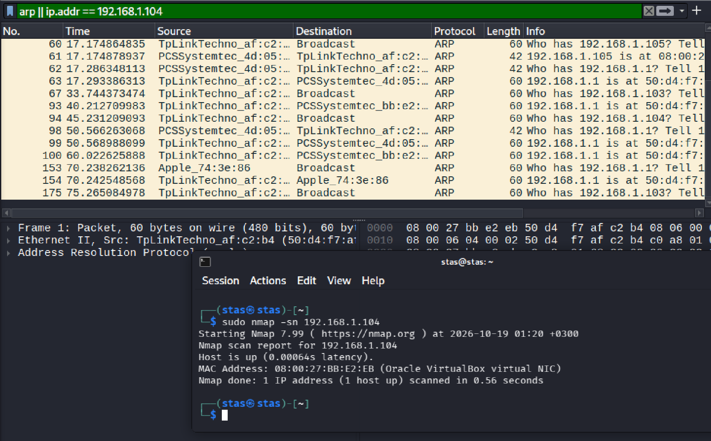
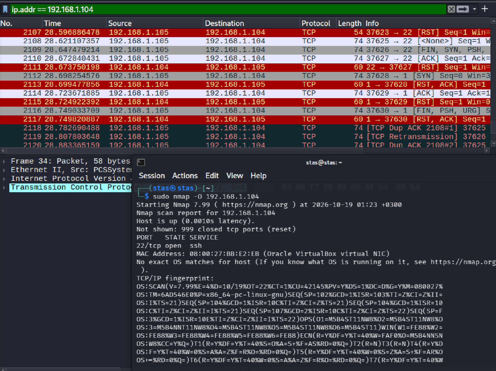
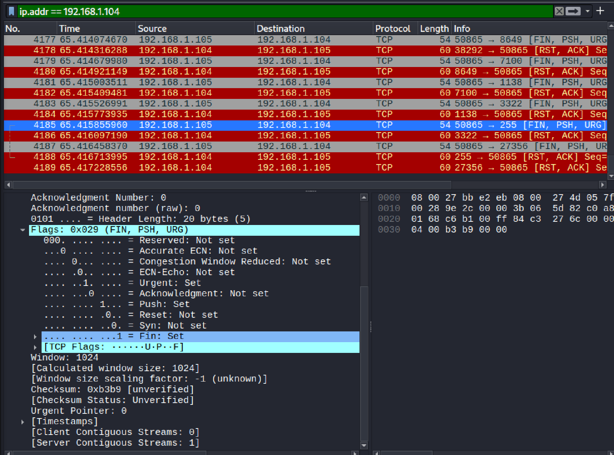
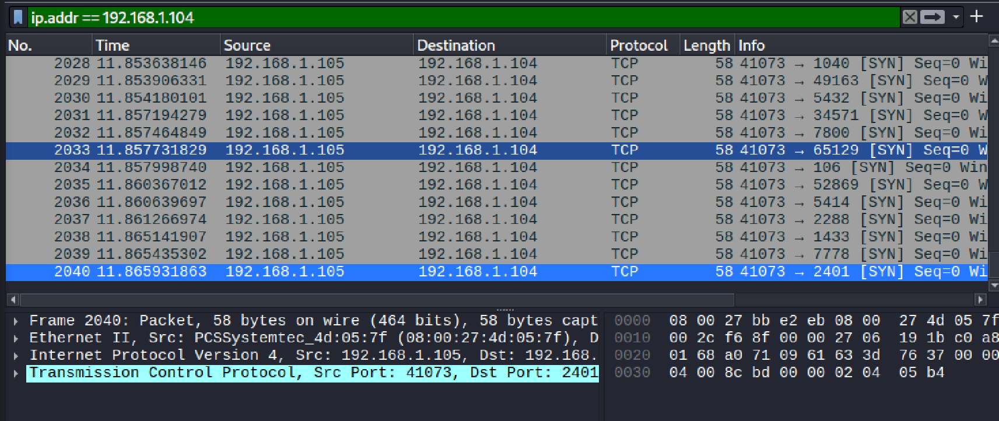

# Звіт до практичної роботи: Аналіз сканування Nmap за допомогою Wireshark

## 1. Підготовка середовища (IP-адреси)

## 2. TCP Connect Scan (`-sT`)

## 3. UDP Scan (`-sU`)

## 4. Ping Scan (`-sn`)

## 5. OS Detection (`-O`)

## 6. Бонусні завдання

### Xmas Scan (`-sX`)

### Додаткове сканування / UFW
